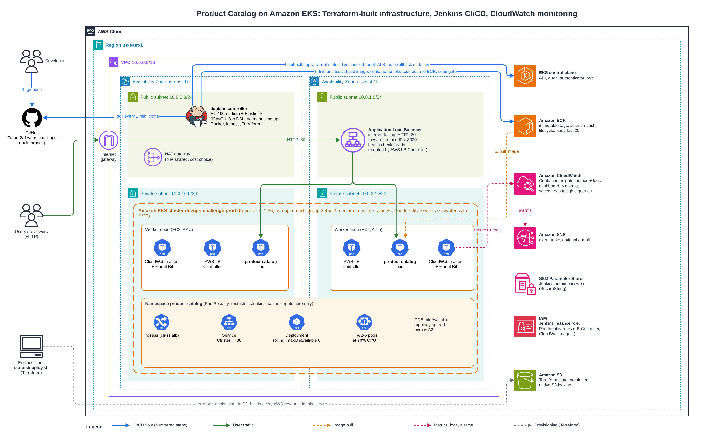

# Product Catalog: production-style deployment on Amazon EKS

A small Node.js REST API, deployed to AWS with the full delivery path automated:

- **Terraform** builds everything: network, EKS cluster, load balancer controller, container registry, CloudWatch monitoring and the Jenkins server itself.
- **Jenkins** (configured entirely as code) builds, tests, scans and deploys every commit to `main`, checks the new version is live and rolls back if it is not.
- **Docker** packages the app in a small, non-root image.
- **CloudWatch** collects metrics and logs from the cluster, with a dashboard and alarms.

After the one-time `scripts/deploy.sh`, there are no manual steps. A `git push` is the deployment.

| | |
|---|---|
| App | `http://<alb-dns-name>/health`, `/api/v1/products` (URL printed by each Jenkins build) |
| Jenkins | `http://<jenkins-ip>:8080/job/product-catalog/` (read-only without login) |
| Region | us-east-1 |

---

## Contents

1. [Architecture](#1-architecture)
2. [Repository layout](#2-repository-layout)
3. [CI/CD pipeline](#3-cicd-pipeline)
4. [Deployment steps](#4-deployment-steps)
5. [Monitoring and logging](#5-monitoring-and-logging)
6. [Design decisions](#6-design-decisions)
7. [Security](#7-security)
8. [Assumptions](#8-assumptions)
9. [Limitations and improvements](#9-limitations-and-improvements)
10. [Cost](#10-cost)
11. [The application](#11-the-application)

---

## 1. Architecture



The editable source is [`docs/architecture.drawio`](docs/architecture.drawio) (open it at [app.diagrams.net](https://app.diagrams.net)).

### Request path

`User → Internet gateway → Application Load Balancer (public subnets) → pod IPs on port 3000 (private subnets)`

The ALB is created from the Kubernetes `Ingress` by the AWS Load Balancer Controller. It sends traffic straight to pod IPs (`target-type: ip`) and only to pods whose `/ready` check passes.

### Delivery path

1. A developer pushes to `main` on GitHub.
2. Jenkins polls the repository every 2 minutes and starts a build on a new commit.
3. Jenkins lints and tests the code, builds the image, runs it once as a smoke test, pushes it to ECR and blocks on critical vulnerabilities from the ECR scan.
4. Jenkins applies the Kubernetes manifests to EKS, waits for the rolling update, then calls the app through the ALB and checks that `/health` reports the new version. If anything fails after the deploy started, it runs `kubectl rollout undo`.
5. EKS nodes pull the image from ECR.

### What Terraform creates

| Area | Resources |
|---|---|
| Network (`modules/vpc`) | VPC `10.0.0.0/16` across 2 AZs, 2 public `/24` + 2 private `/20` subnets, internet gateway, NAT gateway (1 or one per AZ), route tables, subnet tags for load balancer discovery |
| Registry (`modules/ecr`) | ECR repository with immutable tags, scan on push, lifecycle rules |
| Kubernetes (`modules/eks`) | EKS 1.36 cluster (API access entries, KMS-encrypted secrets, control plane logs), managed node group of 2 to 4 `t3.medium` in private subnets, add-ons: VPC CNI, CoreDNS, kube-proxy, Pod Identity agent, metrics-server, Amazon CloudWatch Observability |
| Ingress (`modules/load-balancer-controller`) | AWS Load Balancer Controller (Helm) with its IAM role through EKS Pod Identity |
| CI/CD (`modules/jenkins`) | EC2 Jenkins controller with Elastic IP, instance role, namespace-scoped EKS access, admin password in SSM Parameter Store, auto-recovery alarm |
| Monitoring (`modules/monitoring`) | SNS alarm topic, 6 CloudWatch alarms, a dashboard and saved Logs Insights queries |
| Remote state (`terraform/bootstrap`) | Versioned, encrypted S3 bucket with native state locking |

---

## 2. Repository layout

```
.
├── app/                              Node.js service
│   ├── src/
│   │   ├── app.js                    Express app: routes, /health, /ready, error handling
│   │   ├── index.js                  Server start and graceful shutdown on SIGTERM
│   │   ├── logger.js                 JSON logs (one object per line, for CloudWatch)
│   │   ├── routes/ controllers/      Products API
│   ├── tests/products.test.js        Jest + Supertest (9 tests)
│   ├── Dockerfile                    deps -> test -> runtime stages, non-root, Node 24 Alpine
│   └── eslint.config.js
├── k8s/                              Manifests applied by Jenkins
│   ├── configmap.yaml  deployment.yaml  service.yaml
│   ├── ingress.yaml                  ALB settings
│   ├── hpa.yaml                      2 to 6 pods at 70% CPU
│   └── pdb.yaml                      keeps 1 pod during node maintenance
├── terraform/
│   ├── bootstrap/                    S3 state bucket (run once)
│   ├── modules/
│   │   ├── vpc/  ecr/  eks/
│   │   ├── load-balancer-controller/ (includes the pinned IAM policy)
│   │   ├── jenkins/                  (user data + Jenkins Configuration as Code templates)
│   │   └── monitoring/
│   └── environments/prod/            Wires the modules together; terraform.tfvars holds prod settings
├── scripts/
│   ├── deploy.sh                     bootstrap + apply in one command
│   └── destroy.sh                    removes the ALB first, then terraform destroy
├── docs/architecture.drawio|png
└── Jenkinsfile
```

---

## 3. CI/CD pipeline

Defined in [`Jenkinsfile`](Jenkinsfile). The Jenkins job itself is created by Job DSL inside Jenkins Configuration as Code ([`casc.yaml.tftpl`](terraform/modules/jenkins/templates/casc.yaml.tftpl)), so nobody clicks through the Jenkins UI.

| # | Stage | What happens | Fails the build when |
|---|---|---|---|
| 1 | Prepare | Image tag = `<build number>-<short commit>` | |
| 2a | App: lint and unit tests | ESLint, then Jest with coverage, inside a `node:24-alpine` container. JUnit results are published to Jenkins | lint error, failing test, line coverage under 80% |
| 2b | Terraform: fmt and validate | `terraform fmt -check` and `terraform validate` for every module and environment (runs in parallel with 2a) | unformatted or invalid Terraform |
| 3 | Build image | Builds the Dockerfile `test` stage (tests run again in the image toolchain), then the `runtime` image | build or in-image test failure |
| 4 | Container smoke test | Runs the image, calls `/health` and `/api/v1/products` | container doesn't start or answer |
| 5 | Push to ECR | Logs in with the instance role, pushes the immutable tag | |
| 6 | Vulnerability gate | Waits for the ECR scan, reads severity counts | any CRITICAL finding (HIGH too if chosen) |
| 7 | Deploy to EKS | Renders image tag into `k8s/*.yaml`, server-side dry run, `kubectl apply`, waits for the rollout | dry run rejected, rollout not healthy in 5 min |
| 8 | Live smoke test | Gets the ALB address from the Ingress, polls `/health` until it reports the new version, checks the products endpoint | new version not serving through the ALB in 10 min |
| | Post: failure | `kubectl rollout undo` if stage 7 had started | |
| | Post: cleanup | Removes local images and the workspace | |

Build parameters: `SKIP_DEPLOY` (build and push only) and `BLOCK_ON_SEVERITY` (`CRITICAL`, `HIGH` or `NONE`).

**Rolling update with no downtime.** `maxUnavailable: 0` and `maxSurge: 1` mean a new pod must pass its readiness check before an old one stops. On `SIGTERM` the app fails `/ready` first, waits 10 seconds for the ALB to stop sending it traffic (the target group deregistration delay is 5 seconds), then closes.

---

## 4. Deployment steps

### Prerequisites

- AWS account and credentials with administrator rights (`aws sts get-caller-identity` works)
- Terraform 1.10 or later (for S3 native state locking)
- AWS CLI v2, and `kubectl` if you want to look at the cluster yourself
- The repository on GitHub (Jenkins clones it over HTTPS; a public repo needs no credentials)

Docker and Node.js are **not** needed locally. Jenkins builds and tests everything.

### Deploy

```bash
git clone https://github.com/Turner2/devops-challenge.git
cd devops-challenge
./scripts/deploy.sh            # shows the plan and asks for approval
# or: ./scripts/deploy.sh -auto-approve
```

`deploy.sh`:

1. Creates the S3 state bucket `devops-challenge-tfstate-<account-id>` with `terraform/bootstrap`, unless it already exists.
2. Initialises `terraform/environments/prod` against that bucket and runs `terraform apply`.

It takes about 20 minutes, mostly the EKS cluster and node group. When it finishes it prints the outputs:

```
jenkins_url                    = "http://<ip>:8080/"
jenkins_job_url                = "http://<ip>:8080/job/product-catalog/"
jenkins_admin_password_command = "aws ssm get-parameter ... --with-decryption ..."
configure_kubectl              = "aws eks update-kubeconfig --region us-east-1 --name devops-challenge-prod"
app_url_command                = "kubectl get ingress product-catalog -n product-catalog -o jsonpath=..."
cloudwatch_dashboard_url       = "https://us-east-1.console.aws.amazon.com/cloudwatch/home?..."
```

### What happens next, without any action

1. The Jenkins instance installs Jenkins, plugins, Docker, kubectl and Terraform, then starts with the job already defined (about 5 minutes).
2. About a minute after start-up, Jenkins runs the first build. It deploys the app and creates the ALB (about 8 minutes the first time, because the ALB and its DNS name are new).
3. The build page shows the app URL in its description.

### Verify

```bash
# App
curl http://<alb-dns-name>/health
curl http://<alb-dns-name>/api/v1/products
curl "http://<alb-dns-name>/api/v1/products?category=electronics"

# Cluster
aws eks update-kubeconfig --region us-east-1 --name devops-challenge-prod
kubectl get pods,svc,ingress,hpa,pdb -n product-catalog
kubectl get pods -n amazon-cloudwatch          # CloudWatch agent + Fluent Bit
kubectl rollout history deployment/product-catalog -n product-catalog
```

### Ship a change

```bash
# edit app/src/..., then
git commit -am "feat: ..." && git push
```

Jenkins picks it up within 2 minutes. `rollout history` shows the image tag of every release as its change cause.

### Roll back by hand

```bash
kubectl rollout undo deployment/product-catalog -n product-catalog
```

Or re-run an older Jenkins build with its tag. Images are immutable, so a tag always means the same code.

### Tear down

```bash
./scripts/destroy.sh
```

The ALB was created by Kubernetes, so Terraform does not know about it. The script deletes the Ingress first and waits for the controller to remove the ALB, otherwise the VPC cannot be deleted. The state bucket is kept on purpose (it has `prevent_destroy`).

---

## 5. Monitoring and logging

All of it is created by Terraform, nothing is clicked together in the console.

**Metrics (CloudWatch Container Insights).** The `amazon-cloudwatch-observability` EKS add-on runs the CloudWatch agent on every node. It reports node, pod, container and service metrics to the `ContainerInsights` namespace.

**Logs.**

| Log group | Content |
|---|---|
| `/aws/containerinsights/devops-challenge-prod/application` | Every container's stdout/stderr (Fluent Bit). The app writes one JSON object per line, for example `{"level":"info","message":"request","method":"GET","path":"/api/v1/products","status":200,"durationMs":1.2}` |
| `/aws/containerinsights/devops-challenge-prod/{host,dataplane,performance}` | Node, kubelet and performance logs |
| `/aws/eks/devops-challenge-prod/cluster` | EKS control plane: API server, audit, authenticator |

Every log group has 14-day retention.

**Dashboard** `devops-challenge-prod-product-catalog`: ALB requests, 5xx and p95 latency, running pods and restarts, pod CPU and memory against their limits, node CPU, memory and count, recent application errors, and alarm status.

**Alarms** (to the SNS topic `devops-challenge-prod-alarms`; set `alarm_email` in `terraform.tfvars` to get e-mails):

| Alarm | Fires when |
|---|---|
| running-pods-low | fewer than 2 pods behind the service for 3 minutes |
| container-restarts | 2 or more container restarts in 5 minutes |
| cpu-high / memory-high | pod CPU or memory above 80% of its limit for 10 minutes |
| node-cpu-high | average node CPU above 80% for 15 minutes |
| failed-nodes | any node reports a failed condition |
| jenkins-system-check | Jenkins host fails its EC2 system check (the alarm also recovers the instance) |

**Saved Logs Insights queries:** `errors` and `requests-by-status` (count, average and p95 latency per HTTP status).

---

## 6. Design decisions

**EKS rather than ECS or plain EC2.** The app is small, so ECS on Fargate would have been simpler and cheaper. I kept EKS because it gives standard tooling for the things the brief asks about: rolling updates with readiness gates, a Horizontal Pod Autoscaler, Pod Disruption Budgets, and namespaces to limit what the pipeline may touch. The trade-off is the $73 a month control plane and more moving parts.

**AWS Load Balancer Controller + ALB Ingress.** EKS can create a Classic Load Balancer from a `Service` without any controller, but AWS documents that path as legacy. The controller creates an ALB that sends traffic straight to pod IPs and health-checks `/ready`, so a pod only gets traffic when it is ready. Its IAM policy is stored next to the module and named after the chart version, so the two are upgraded together.

**Jenkins on EC2, configured as code.** Jenkins was the preferred tool in the brief. To keep it repeatable, Terraform builds the server and Jenkins Configuration as Code sets up the admin user, security, global settings and the job. If the instance is lost, `terraform apply` brings back an identical Jenkins. The pipeline uses the instance role, so there are no AWS keys in Jenkins.

**Pipeline triggers by polling.** Polling every 2 minutes works with any repository and needs no GitHub admin rights or inbound webhook. A webhook would trigger faster and is listed as an improvement.

**Namespace-scoped deploy rights.** Jenkins gets the EKS `AmazonEKSEditPolicy` for the `product-catalog` namespace only, through an EKS access entry. It cannot change other namespaces or cluster-wide objects. Terraform owns the namespace so this scope can exist before the first deploy.

**EKS Pod Identity instead of IRSA.** The load balancer controller and the CloudWatch agent get their IAM roles through Pod Identity. There is no OIDC provider to manage, and the trust policy is the same for every role.

**Modular Terraform with one environment folder per environment.** Each module has one job and its own variables and outputs. `environments/prod` only wires modules together. A staging environment would be a new folder with its own `terraform.tfvars` and state key, reusing the same modules.

**Remote state in S3 with native locking.** Terraform 1.10 can lock state with a lock file in the same S3 bucket (`use_lockfile = true`), so no DynamoDB table is needed. The bucket is versioned, encrypted, private and TLS-only.

**Tests run in two places.** Jenkins runs lint and tests first to fail fast and publish results. The Dockerfile's `test` stage runs them again with the exact image toolchain, so the image that ships was built from tested code.

**Immutable image tags.** Every image is tagged `<build>-<commit>` and ECR refuses to overwrite a tag. What runs in the cluster can always be traced to a commit, and rollbacks are exact.

**One NAT gateway.** The prod `terraform.tfvars` uses a single NAT gateway to save about $33 a month. If its AZ fails, nodes in the other AZ lose outbound internet (pulling images, sending logs), but traffic coming in through the ALB keeps working. `single_nat_gateway = false` gives one per AZ.

---

## 7. Security

- Worker nodes and pods run in private subnets with no public IPs. Only the ALB and Jenkins are public.
- Containers run as a fixed non-root user (UID 10001) with a read-only root filesystem, no Linux capabilities and no privilege escalation. The namespace enforces the Kubernetes `restricted` Pod Security Standard, so a pod that drops these settings is rejected.
- The app's pods don't mount a Kubernetes API token, since the app never calls the API.
- Kubernetes Secrets are encrypted with a KMS key with rotation.
- IMDSv2 is required on Jenkins, with a hop limit of 1 so build containers cannot use the instance role.
- No long-lived AWS keys anywhere: Jenkins uses its instance role, add-ons use Pod Identity, and people use their own IAM identity through EKS access entries.
- The Jenkins admin password is generated by Terraform and kept in SSM Parameter Store as a SecureString. User data reads it at boot, so it is never in user data.
- Images are scanned on push and the pipeline blocks critical findings.
- Nodes and Jenkins are reachable through SSM Session Manager. There are no SSH keys or open SSH ports.

---

## 8. Assumptions

- One AWS account and one region (us-east-1) are enough for this exercise.
- The person who runs `deploy.sh` has administrator rights. That identity also becomes EKS cluster admin.
- The GitHub repository is public, so Jenkins can clone it without credentials.
- Plain HTTP is acceptable for the review, because there is no domain to issue a certificate for.
- The Jenkins UI is open to the internet during the review (`jenkins_allowed_cidrs = ["0.0.0.0/0"]`) so assessors can view builds. Anonymous users can only read. Everything else needs the admin login.
- The app is stateless: products are held in memory. A database is out of scope.

---

## 9. Limitations and improvements

| Limitation | Why | Improvement |
|---|---|---|
| HTTP only, no custom domain | no domain owned for the challenge | Route 53 record + ACM certificate on the ALB, redirect HTTP to HTTPS (one Ingress annotation each) |
| Jenkins is one instance and builds on the controller | simplest setup that is fully automated | Run builds on ephemeral agents (EC2 or Kubernetes agents), back up `JENKINS_HOME` to EBS snapshots or EFS, put Jenkins behind an ALB with TLS and SSO |
| Jenkins UI is reachable from anywhere during the review | assessors need to see builds | Restrict `jenkins_allowed_cidrs` to a VPN or office IP, or reach it only through SSM port forwarding |
| Pipeline polls GitHub every 2 minutes | no webhook setup needed | GitHub webhook or the GitHub Branch Source plugin, with multibranch builds and PR checks |
| One environment, straight to prod | scope of the challenge | Add `environments/staging`, deploy there first, run smoke tests, then promote the same image tag to prod with an approval step |
| Infrastructure changes are applied by a person | Jenkins only has deploy rights, on purpose | A separate infrastructure pipeline that runs `terraform plan` on PRs and `apply` after approval, with its own IAM role |
| Node count is fixed between 2 and 4 by hand | no cluster autoscaler installed | Karpenter or EKS Auto Mode to add and remove nodes with demand |
| Kubernetes manifests are rendered with `sed` | few manifests, one environment | Helm chart or Kustomize overlays per environment, or Argo CD for GitOps |
| ECR basic scanning only checks OS packages | free and built in | Amazon Inspector enhanced scanning (also scans npm packages), image signing, SBOM |
| One NAT gateway | cost | `single_nat_gateway = false` |
| No ALB 5xx alarm | the ALB is created by Kubernetes, so Terraform doesn't know its ID when the alarms are made | Alarm on ALB metrics after the first deploy, or switch to AWS Load Balancer Controller `TargetGroupBinding` with a Terraform-managed ALB |
| No WAF | not needed for a demo API | AWS WAF on the ALB with the AWS managed rule groups |
| No database or persistence | stateless demo app | RDS or DynamoDB, with credentials from Secrets Manager through Pod Identity |

---

## 10. Cost

Approximate us-east-1 on-demand prices, running 24/7:

| Item | Monthly |
|---|---|
| EKS control plane | $73 |
| 2 x t3.medium worker nodes | $61 |
| t3.medium Jenkins | $30 |
| NAT gateway (1) + data | $33+ |
| Application Load Balancer | $17+ |
| 4 public IPv4 addresses (NAT, Jenkins, ALB x2) | $15 |
| EBS (3 x 30 GB gp3) | $7 |
| CloudWatch (Container Insights, logs, alarms, dashboard), KMS | $15 to 25 |
| **Total** | **about $250 a month, or about $8 a day** |

Run `./scripts/destroy.sh` when the review is finished.

---

## 11. The application

Express service on port 3000.

| Method | Path | Response |
|---|---|---|
| GET | `/health` | `200 {status, service, version, timestamp}`, used by the liveness and startup probes and the smoke tests |
| GET | `/ready` | `200 {status: "ready"}`, or `503` while shutting down. Used by the readiness probe and the ALB health check |
| GET | `/api/v1/products` | `200 {count, products[]}` |
| GET | `/api/v1/products?category=electronics` | filtered list |
| GET | `/api/v1/products/:id` | one product or `404` |

Run it locally:

```bash
cd app
npm ci
npm test            # 9 tests with coverage
npm start           # http://localhost:3000/health
docker build -t product-catalog . && docker run -p 3000:3000 product-catalog
```
